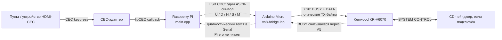

# Архитектура Kenwood XS Remote

Система переносит команды громкости и отключения звука из HDMI-CEC на шину SYSTEM CONTROL (XS8) ресивера Kenwood. Текущая реализация состоит из процесса на Raspberry Pi и прошивки Arduino Micro. Схема ниже отражает **реальный путь команд в исходном коде**; описание сигналов XS8 и границы экспериментального подтверждения приведены в [спецификации интерфейса](xs8-protocol.md).

## Компоненты и границы ответственности

| Компонент | Что делает сейчас |
|---|---|
| [Raspberry Pi: `main.cpp`](../main.cpp) | Открывает `/dev/ttyACM0`, подключается к первому найденному CEC-адаптеру через libCEC, принимает события кнопок, отслеживает нажатие/отпускание и посылает однобайтовые serial-команды Arduino. Обрабатываются только `VOLUME_UP`, `VOLUME_DOWN` и `MUTE`. |
| [Arduino Micro: `xs8-bridge.ino`](../xs8-bridge/xs8-bridge.ino) | Принимает символы по USB CDC, управляет состояниями `active`, `stopPending` и `contextOpen`, формирует отдельные кадры XS8 и следит за занятостью BUSY перед передачей. |
| Ресивер Kenwood | Принимает кадры XS8. Наблюдаемые команды громкости и MUTE работают после `x17`; `x09` останавливает непрерывное изменение громкости, `x07` возвращает проверенную интерпретацию ROOT. Семантическое имя контекста `x17` не установлено. |
| CD-чейнджер | Участвует в общей шине и может генерировать собственные сообщения. Он не нужен для текущего сопоставления CEC-громкости, но его присутствие и состояние влияли на часть исследовательских наблюдений. |

Arduino передаёт BUSY через D3 и DATA через D2, оба через резисторы 2,2 кОм; A5 считывает BUSY, A0 подключён к DATA, земля общая. В текущей прошивке A0 настроен как вход, но не используется для разбора ответных XS8-кадров. Передача HIGH выполняется выходом Arduino, LOW — отпусканием линии в высокоимпедансный вход. Это проверенная конфигурация данного стенда, а не универсальная электрическая спецификация Kenwood. [Код передачи](../xs8-bridge/xs8-bridge.ino), [исследовательские заметки](../research/notes/kenwood-xs-reverse-engineering-reviewed.md)

## Инициализация и сопоставление кодов

При старте Arduino отпускает обе линии XS8, включает USB Serial и печатает `XS8 BRIDGE 1.0 READY`. Процесс Pi открывает `/dev/ttyACM0` в raw-режиме с номинальной скоростью 115200, **до запуска libCEC** отправляет символ `S`, затем регистрирует себя как CEC `AUDIO_SYSTEM` с именем `Kenwood Bridge`. Код не активирует источник (`bActivateSource = 0`), не задаёт пробуждение устройств, открывает первый найденный адаптер и вызывает `SetInactiveView()`. [Инициализация Pi](../main.cpp), [инициализация Arduino](../xs8-bridge/xs8-bridge.ino)

Начальный `S` вызывает `finishVolume()` на Arduino. Эта функция отправляет XS8 `x09` только при сохранённом `active` или `stopPending`, а `x07` — только при `contextOpen`. Поэтому `S` синхронизирует **известное прошивке состояние**; после её чистого старта он может не породить ни одного кадра XS8 и не доказывает, что ресивер уже в ROOT. [Условия `finishVolume()`](../xs8-bridge/xs8-bridge.ino)

В таблице `xNN` — **текущие логические TX-байты XS8**, а буквы — ASCII-символы USB serial, не XS8-байты. `sendXS8()` в `main.cpp` сопоставляет `xF9 → U`, `xE9 → D`, `x09 → S`, `xD8 → M`; последовательности XS8 собирает Arduino. [Сопоставление в Pi](../main.cpp), [разбор в Arduino](../xs8-bridge/xs8-bridge.ino)

| Событие / источник | Pi → Arduino | Arduino → XS8, точный порядок | Условие |
|---|---|---|---|
| CEC `VOLUME_UP`, начало нажатия | `U` | `x17 → xF9` | Если уже удерживается то же направление, новая XS8-передача не нужна. |
| CEC `VOLUME_DOWN`, начало нажатия | `D` | `x17 → xE9` | Смена направления сначала завершает прежнее удержание: `x09 → x07`, затем начинает новое. |
| Повтор/удержание громкости | `H` каждые ~300 мс | Нового кадра XS8 нет | Pi посылает heartbeat, пока считает громкость активной; Arduino обновляет свой таймер. |
| Отпускание активной кнопки, остановка или завершение процесса | `S` | `x09 → x07`, если состояние Arduino требует обоих кадров | **Сначала STOP, затем выход из контекста.** |
| CEC `MUTE`, начало нажатия | `M` | `x17 → xD8 → x07` | Если громкость активна, Arduino сначала выполняет `x09 → x07`. Отпускание MUTE не посылает нового действия. |
| Ручной запрос состояния serial | `?` | XS8-кадров нет | Arduino печатает `active`, `context`, `stopPending`; текущий Pi-код `?` не посылает. |

USB-протокол — поток **одиночных символов без обязательного перевода строки**. Arduino игнорирует пробелы и CR/LF, печатает `OK ...` или `ERR ...`, но Pi читает только результат системного `write()` и **не разбирает ответы Arduino**. Следовательно, успешная запись в serial не является подтверждением передачи XS8 или реакции ресивера. [Запись serial в Pi](../main.cpp), [ответы Arduino](../xs8-bridge/xs8-bridge.ino)

## Временная логика и отказы

CEC callback помещает события в очередь; основной цикл Pi обрабатывает её примерно каждые 20 мс. В текущем коде `duration > 0` трактуется как отпускание. Pi посылает `S` при отпускании, смене направления, завершении процесса или отсутствии событий громкости более 1200 мс. Пока удержание активно, он посылает `H` примерно каждые 300 мс. Arduino имеет собственный тайм-аут 1200 мс с последующим `x09 → x07`. [Цикл событий](../main.cpp), [watchdog прошивки](../xs8-bridge/xs8-bridge.ino)

Каждый XS8-байт передаётся отдельным кадром после проверки свободной BUSY-линии. Arduino ждёт BUSY LOW не менее 500 мкс, но прекращает ожидание через 100 мс. Если STOP или выход в ROOT не удалось отправить, прошивка сохраняет флаги для повторной попытки. Если BUSY остаётся занятой постоянно, ни watchdog Pi, ни watchdog Arduino не гарантируют, что STOP дойдёт до ресивера. [Ожидание BUSY и повтор](../xs8-bridge/xs8-bridge.ino)

## Границы реализации и доказательств

- Сейчас CEC-путь управляет только громкостью и MUTE. Команды выбора источника, CD и запрос статуса описаны в [реестре команд](../research/COMMAND_REGISTRY.md), но `main.cpp` их не выдаёт.
- `x17`/`x07` демонстрируют переключение и восстановление наблюдаемой интерпретации команд; формальная семантика контекста неизвестна. Не следует считать одинаковые байты эквивалентными во всех состояниях ресивера.
- Код фиксирует фактическое сопоставление CEC → serial → XS8. В архиве нет полного синхронного лога этого пути, поэтому утверждение об аппаратной проверке моста нельзя независимо восстановить по всем этапам. [История исследования](../research/RESEARCH_HISTORY.md), [спецификация XS8](xs8-protocol.md)
