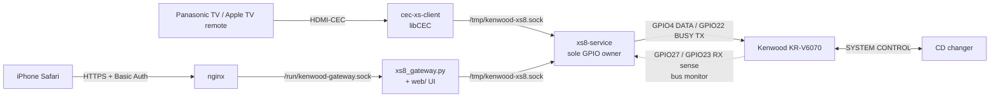
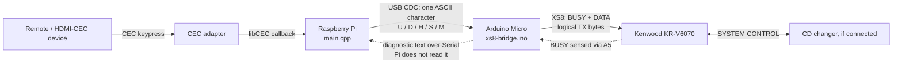

# Kenwood XS Remote architecture

The current system drives the Kenwood KR-V6070's SYSTEM CONTROL (XS8) bus **directly from Raspberry Pi GPIO**. A single XS8 Service owns the bus. The HDMI-CEC client and the authenticated Web Remote are both clients of that service. Capability and validation status is kept in [project status](project-status.md); XS8 signals and evidence limits are in the [interface specification](xs8-protocol.md).

## Current architecture

| Component | Responsibility |
|---|---|
| [`xs8-service`](../xs8_service.cpp) | The only GPIO owner. It transmits each frame after a BUSY-free check and checks it with the RX monitor (`TX_OK`, `MATCH`). It owns every multi-frame transaction: volume hold and step with STOP before ROOT, MUTE, the CONTEXT keys (VIDEO1/VIDEO2, TAPE2 MONITOR), CD pairs and holds with RELEASE obligations, and POWER. It latches faults rather than retrying, tracks receiver source and MONITOR from broadcasts and `QUERY_STATUS` (plain or SETTLE), and serves up to eight local socket clients. |
| [`cec-xs-client`](../cec_xs_client.cpp) | Maps CEC volume keys to `VOLUME_PRESS`/`VOLUME_RELEASE` and the MUTE key to `MUTE`. It opens no GPIO ([CEC client](cec-client.md)). |
| [`xs8_gateway.py`](../xs8_gateway.py) | HTTP API and static Web UI on a systemd-activated Unix socket behind nginx. Each control has a default-off `--enable-*` gate and needs a session, a one-use CSRF token, an exact Origin and a fresh eligible STATUS. Gateway-wide locks and spacing serialize requests. It runs the post-command SYNC readback and the one-click POWER decision, and never retries a state-changing command ([Web API](web-api.md)). |
| [`web/`](../web/) | Browser UI. It shows only observed receiver state, never state inferred from a TX reply. |
| nginx | TLS, Basic Auth and identity headers on the LAN ([HTTPS](https-lan.md)). |

Service replies keep `receiver_execution=UNVERIFIED`: transmission evidence is never treated as proof that the receiver acted.

## Legacy: original Arduino USB bridge (historical)

The rest of this document describes the **original** design, in which `main.cpp` sent one-character serial commands to an Arduino Micro running [`xs8-bridge.ino`](../xs8-bridge/xs8-bridge.ino). Since then, `main.cpp` (`cec-xs-bridge`) has been converted to drive GPIO itself through `VolumeControl`. It remains only as a fallback and must never run alongside `xs8-service`. The Arduino firmware is kept for reference. The serial mapping below is the historical one and no longer matches `main.cpp`.

### Components and responsibilities

| Component | What it currently does |
|---|---|
| [Raspberry Pi: `main.cpp`](../main.cpp) | Opens `/dev/ttyACM0`, connects to the first detected CEC adapter through libCEC, receives key events, tracks presses and releases, and sends one-byte serial commands to the Arduino. Only `VOLUME_UP`, `VOLUME_DOWN`, and `MUTE` are handled. |
| [Arduino Micro: `xs8-bridge.ino`](../xs8-bridge/xs8-bridge.ino) | Receives characters over USB CDC, manages `active`, `stopPending`, and `contextOpen`, generates separate XS8 frames, and checks whether BUSY is occupied before transmitting. |
| Kenwood receiver | Receives XS8 frames. The observed volume and MUTE commands work after `x17`; `x09` stops continuous volume changes, and `x07` restores the tested ROOT interpretation. The semantic name of the `x17` context is not established. |
| CD changer | Participates in the shared bus and can generate its own messages. It is not needed for the current CEC volume mapping, but its presence and state affected some research observations. |

The Arduino transmits BUSY through D3 and DATA through D2, each through a 2.2 kΩ resistor; A5 senses BUSY, A0 is connected to DATA, and ground is shared. In the current firmware, A0 is configured as an input but is not used to decode received XS8 frames. The Arduino drives HIGH with an output and produces LOW by releasing the line to a high-impedance input. This is the verified configuration of this test setup, not a universal Kenwood electrical specification. [Transmit code](../xs8-bridge/xs8-bridge.ino), [research notes](../research/notes/kenwood-xs-reverse-engineering-reviewed.md)

### Initialization and code mapping

At startup, the Arduino releases both XS8 lines, starts USB Serial, and prints `XS8 BRIDGE 1.0 READY`. The Pi process opens `/dev/ttyACM0` in raw mode at a nominal 115200 baud, sends the character `S` **before starting libCEC**, then registers as a CEC `AUDIO_SYSTEM` named `Kenwood Bridge`. The code does not activate the source (`bActivateSource = 0`) or configure device wake-up; it opens the first detected adapter and calls `SetInactiveView()`. [Pi initialization](../main.cpp), [Arduino initialization](../xs8-bridge/xs8-bridge.ino)

The initial `S` calls `finishVolume()` on the Arduino. That function sends XS8 `x09` only if `active` or `stopPending` is set, and `x07` only if `contextOpen` is set. Thus `S` synchronizes the **state known to the firmware**; after a clean firmware start, it may produce no XS8 frames and does not prove that the receiver is already in ROOT. [`finishVolume()` conditions](../xs8-bridge/xs8-bridge.ino)

In the table, `xNN` denotes **current logical XS8 TX bytes**, while the letters are USB serial ASCII characters, not XS8 bytes. `sendXS8()` in `main.cpp` maps `xF9 → U`, `xE9 → D`, `x09 → S`, and `xD8 → M`; the Arduino assembles the XS8 sequences. [Pi mapping](../main.cpp), [Arduino command parsing](../xs8-bridge/xs8-bridge.ino)

| Event / source | Pi → Arduino | Arduino → XS8, exact order | Condition |
|---|---|---|---|
| CEC `VOLUME_UP`, start of press | `U` | `x17 → xF9` | If the same direction is already held, another XS8 transmission is unnecessary. |
| CEC `VOLUME_DOWN`, start of press | `D` | `x17 → xE9` | A direction change first ends the previous hold with `x09 → x07`, then starts the new one. |
| Volume repeat/hold | `H` every ~300 ms | No new XS8 frame | The Pi sends a heartbeat while it considers volume active; the Arduino updates its timer. |
| Release of the active button, stop, or process shutdown | `S` | `x09 → x07` if the Arduino state requires both frames | **STOP first, then context exit.** |
| CEC `MUTE`, start of press | `M` | `x17 → xD8 → x07` | If volume is active, the Arduino first performs `x09 → x07`. Releasing MUTE sends no new action. |
| Manual serial status query | `?` | No XS8 frames | The Arduino prints `active`, `context`, and `stopPending`; the current Pi code does not send `?`. |

The USB protocol is a stream of **single characters without a required newline**. The Arduino ignores spaces and CR/LF and prints `OK ...` or `ERR ...`, but the Pi reads only the system `write()` result and **does not parse Arduino responses**. Therefore, a successful serial write is not confirmation of XS8 transmission or receiver response. [Pi serial write](../main.cpp), [Arduino responses](../xs8-bridge/xs8-bridge.ino)

### Timing and failures

The CEC callback puts events in a queue; the Pi's main loop processes it about every 20 ms. In the current code, `duration > 0` is interpreted as a release. The Pi sends `S` on release, direction change, process shutdown, or when no volume event has arrived for more than 1200 ms. While a hold is active, it sends `H` about every 300 ms. The Arduino has its own 1200 ms timeout followed by `x09 → x07`. [Event loop](../main.cpp), [firmware watchdog](../xs8-bridge/xs8-bridge.ino)

Each XS8 byte is transmitted as a separate frame after checking that BUSY is free. The Arduino requires BUSY LOW for at least 500 µs but stops waiting after 100 ms. If STOP or the return to ROOT cannot be sent, the firmware retains flags for another attempt. If BUSY remains occupied indefinitely, neither the Pi watchdog nor the Arduino watchdog can guarantee that STOP reaches the receiver. [BUSY wait and retry](../xs8-bridge/xs8-bridge.ino)

### Implementation and evidence limits

- The CEC path (this legacy bridge, and the current `cec-xs-client`) controls only volume and MUTE. Source selection, CD, POWER and status queries are sent only by the current XS8 Service on behalf of the Web Gateway ([project status](project-status.md)); `main.cpp` does not send them.
- `x17`/`x07` demonstrate a change and restoration of the observed command interpretation; the context's formal semantics are unknown. Identical byte values should not be assumed equivalent in every receiver state.
- The code establishes the actual CEC → serial → XS8 mapping. The archive contains no complete synchronized trace of that path, so the bridge's reported hardware validation cannot be independently reconstructed at every stage. [Research history](../research/RESEARCH_HISTORY.md), [XS8 specification](xs8-protocol.md)
